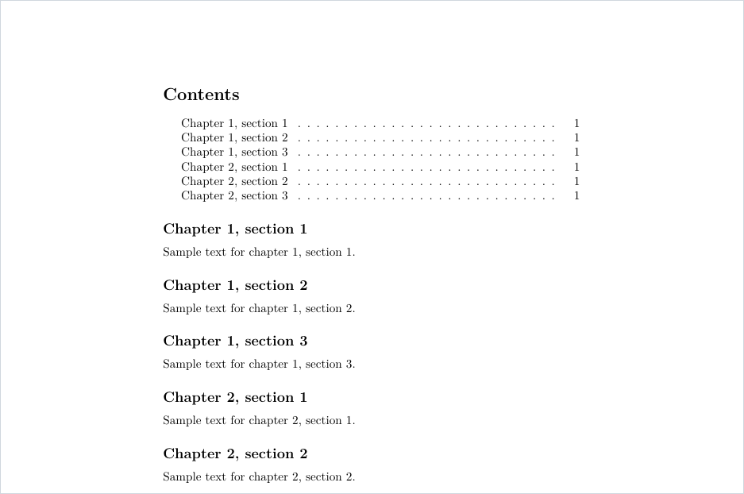

# PDF from Markdown

[](https://github.com/okarabudka/pdf-from-md/actions/workflows/ci.yml)

A PHP command-line tool that compiles a folder of numbered Markdown files, optionally split into chapter folders, into
one PDF book with a table of contents. The PDF itself is rendered by `pandoc` with XeLaTeX.



## Context

Built in January 2025 to turn a set of numbered notes into a single PDF. Revised in November 2026: fixed ordering,
shell escaping and error handling, added tests for each of them, static analysis and CI.

## Features

- Collects files with a given extension (`md` by default) from a directory
- Orders files by the number at the start of their name: `2-body.md` comes before `10-outro.md`; names without a
  number follow in natural order
- Chapter mode: every subdirectory is a chapter; chapters and their files are ordered the same way
- Writes the PDF with a table of contents (`book.pdf` by default) next to the source files
- Every file name and the output path are shell-escaped before `pandoc` is called
- Clear errors and exit code `1` for a missing directory, an empty folder or a failing `pandoc` run

## Tech stack

- PHP 8.3+ (CLI), no runtime dependencies
- pandoc, XeLaTeX (TeX Live)
- PHPUnit 12, PHPStan (level max)
- Docker, Make, GitHub Actions

## Architecture

- `bin/export.php`: CLI entry point; parses options and reports errors
- `src/FileProcessor.php`: file discovery, ordering and the `pandoc` call
- `Dockerfile`: PHP CLI image with pandoc and TeX Live, so nothing has to be installed on the host

## Getting started

```bash
make install                                       # build the image, install dependencies
make pdf DIR=path/to/notes                          # files in one folder
make pdf DIR=path/to/book CHAPTERS=1 OUT=book.pdf   # one subfolder per chapter
```

The folder must be inside the project directory, which is mounted into the container. Without Docker:
`php bin/export.php -p <dir> [-c] [-f md] [-o book.pdf]` with pandoc and XeLaTeX installed locally.

## Testing

```bash
make test   # PHPUnit
make stan   # PHPStan, level max
```

CI runs the tests on PHP 8.3, 8.4 and 8.5 and builds a sample PDF from `tests/mock-files` in Docker.

## Status

Archived. The tool works and is tested, but tools such as pandoc on its own, mdBook or Quarto cover the same use case
with more features, so it is not developed further.

## License

MIT, see [LICENSE](LICENSE).
